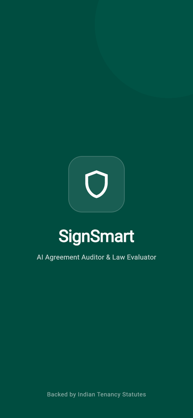

# SignSmart ⚖️

**AI Agreement Risk Auditor, Legal Statute Evaluator & Negotiation Assistant**

SignSmart protects Indian tenants and small business owners from predatory rental agreements. By combining multimodal LLMs with a retrieval-grounded **Indian Tenancy Knowledge Base**, SignSmart extracts hidden traps, verifies clauses against authentic statutory authorities, and empowers tenants with realistic counter-offers, call automation, and WhatsApp drafts.

---

## 🎬 End-to-End Walkthrough Demo & Video



> 📹 **High-Definition Video**: Watch the complete walkthrough in [docs/demo/signsmart_flow_video.webm](docs/demo/signsmart_flow_video.webm).

### 📸 Step-by-Step Flow Gallery

| 1. Splash Screen | 2. Forensic Audit Walkthrough | 3. Statutory Authority |
| :---: | :---: | :---: |
|  |  |  |

| 4. Negotiation Intro | 5. Scanner Dashboard | 6. Audit & Risk Report |
| :---: | :---: | :---: |
|  |  |  |

| 7. Negotiation Studio | 8. Verification Prompt | 9. Round 2 Acceptance |
| :---: | :---: | :---: |
|  |  |  |

| 10. Final Certified Approval | 11. Stamped Certified PDF Document |
| :---: | :---: |
|  |  |

---

## 🌟 What Makes SignSmart Production-Ready

1. **Multimodal Extraction & Risk Profiling**:
   - Reads PDFs and photos of agreements via Google Gemini 2.5 Flash.
   - Deterministic risk & rupee calculation in pure Python—no hallucinated math.
2. **Authentic Indian Law Grounding (Statutory Citations)**:
   - Grounded in official central and state legislation:
     - **Model Tenancy Act, 2021** (§11 advance deposit limits, §23-24 vacation refunds).
     - **The Indian Contract Act, 1872** (§74 prohibition on arbitrary penalties vs reasonable liquidated damages).
     - **The Transfer of Property Act, 1882** (§106 lease duration & statutory notice periods).
     - **The Registration Act, 1908** (§17 & §49 mandatory registration for leases >11 months).
   - Every risk item includes the exact act, section number, official verbatim snippet, and official government link.
3. **Multilingual AI Voice (ElevenLabs)**:
   - Spoken agreement audio breakdown in English, Hindi, and Kannada.
   - Built-in speech synthesis fallback with offline zero-latency mode.
   - In-app inline audio playback with Play, Pause, and Stop controls—zero disturbing external popups.
4. **Negotiation Studio & Landlord Outreach**:
   - Tone selector (🤝 Friendly, ⚖️ Balanced, 📜 Formal Legal) dynamically updating the proposal text in real time.
   - 1-tap Phone Call trigger to contact the landlord.
   - WhatsApp and direct SMS draft dispatch with automated prompt to verify landlord's revised draft.
5. **End-to-End Negotiation & Seal Verification Workflow**:
   - **Accept As-Is**: Tenants satisfied with initial screening can confirm with `"I accept"` to seal the agreement immediately.
   - **Revision Verification Mode**: Seamless 1-tap transition from negotiation to verify amended drafts.
   - **Round 2 Confirmation**: Explicit `"I accept"` confirmation popup before official certification.
   - **Official SignSmart Digital Seal & PDF Download**: Generates and downloads certified agreements stamped with the SignSmart Tenancy Compliance Seal.
6. **Flutter Mobile App (iOS & Android) + PWA Web App**:
   - High-end Material 3 minimalist UI designed with custom Deep Teal (`#00695C`) palette.
   - Camera multi-page capture + PDF document picker.
   - Real-time Admin Directory (`/admin`) tracking all Free vs. Paid users and monetary exposure discovered.
7. **Token & Cost Optimization**:
   - Pre-indexed 61 statute provisions in `app/legal/kb.json` (497 KB).
   - In-memory query caching & SHA-256 prompt deduplication.
   - Strict output token caps to ensure 100% free-tier operation.

---

## 📱 How to Run & Test on iPhone 15

### Option A: Instant Safari Test (No App Store or Xcode needed)
1. Make sure your iPhone 15 and Mac are connected to the same Wi-Fi network.
2. Start the FastAPI backend:
   ```bash
   uvicorn app.main:app --host 0.0.0.0 --port 8000
   ```
3. Open Safari on your iPhone 15 and navigate to:
   ```
   http://192.168.1.4:8000/app
   ```
4. **Install as App**: In Safari, tap the **Share** button (box with upward arrow) -> tap **"Add to Home Screen"**.
   SignSmart will install directly on your iPhone 15 home screen with native full-screen performance, camera support, and document upload!

### Option B: Native iOS Build (via Xcode & USB)
1. Plug your iPhone 15 into your Mac with a USB-C cable.
2. Open terminal in the mobile directory:
   ```bash
   cd mobile
   flutter run -d ios
   ```

---

## 💻 Running the Backend Locally

```bash
# 1. Activate Python virtual environment
source .venv_local/bin/activate

# 2. Start Uvicorn backend
uvicorn app.main:app --host 0.0.0.0 --port 8000 --reload
```

### Key URLs:
- **Mobile Web App**: `http://localhost:8000/app` (or `http://192.168.1.4:8000/app` on iPhone)
- **Admin Directory**: `http://localhost:8000/admin`
- **Interactive Chat**: `http://localhost:8000/chat`
- **System Metrics**: `http://localhost:8000/stats`
- **API Users JSON**: `http://localhost:8000/api/admin/users`

---

## 🏛️ Legal Knowledge Base Architecture

The legal knowledge base is compiled into a lightweight vector archive at `app/legal/kb.json`:
- **Act Texts**: Fetched and parsed from MoHUA (Ministry of Housing and Urban Affairs) official releases and India Code.
- **Embeddings**: Generated using Google's `gemini-embedding-001`.
- **Search & Retrieval**: In-memory cosine similarity matcher (`app/legal/matcher.py`) executes in <5ms with zero external vector database overhead.
